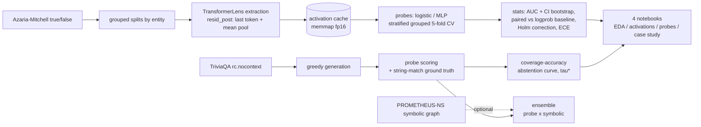

# CASSANDRA

Hallucination detection from internal signals: linear probes trained on residual-stream activations of small open-source models (GPT-2, Pythia-410M) predict whether a statement is factual. The probes are evaluated with grouped cross-validation (by entity), paired bootstrap statistics against a logprob baseline, Holm-Bonferroni correction, calibration analysis, and a selective-abstention curve on free-form generations over TriviaQA. An optional ensemble combines the probe with the symbolic consistency graph of PROMETHEUS-NS.

The statistical showcase lives in four executable notebooks (local Jupyter or Google Colab).

## Architecture



## Repository layout

```text
cassandra_ns/
  config.py               load + validate config.yaml
  data/                   dataset loader, grouped splits, EDA helpers
  activations/            TransformerLens extraction + fp16 memmap cache
  probes/                 training, evaluation, calibration, statistics (stats.py is an anchor)
  generation/             TriviaQA generation + scoring + abstention
  ensemble/               optional symbolic bridge to PROMETHEUS-NS
  report/                 table + figure builders used by notebooks
notebooks/                01 EDA, 02 activations, 03 probe evaluation, 04 case study
scripts/                  CLI entry points + notebook generation + colab setup
tests/                    structural contracts + statistical anchors
```

## Quickstart (local, CPU)

```bash
make setup
make data        # downloads datasets, builds folds.json (committed anchor)
make extract     # activations for gpt2 + pythia-410m
make probe       # grouped-CV probes over the grid
make report      # tables + figures from out-of-fold predictions
make generate    # TriviaQA generations + scoring + abstention
make notebooks   # (re)generate the 4 notebooks and execute them headless
```

## Quickstart (Google Colab)

1. Push this repository to a public GitHub repository.
2. Open any notebook in `notebooks/` at colab.research.google.com.
3. Run cell 1: it detects Colab, clones the repo, installs pinned deps and prepares data. To accelerate Pythia extraction: Runtime > Change runtime type > GPU, BEFORE running cell 1.
4. Run the remaining cells in order. Regenerating notebooks in Colab is unnecessary: the notebooks are committed already executed.

To preview the exact setup cell locally: `make colab`.

## Notebooks

| Notebook | Purpose |
|---|---|
| `01_data_exploration.ipynb` | EDA: domain balance, entity overlap, statement lengths, why grouped CV is required |
| `02_activation_analysis.ipynb` | PCA of residual activations per layer, L2 norms, AUC heatmap layer x domain |
| `03_probe_evaluation.ipynb` | ROC/PR with bootstrap CIs, paired test vs logprob baseline, Holm correction, calibration |
| `04_generation_case_study.ipynb` | Probe vs factual agreement on generations, abstention curve, confabulation case studies |

## Measured metrics

No estimated numbers. The table is populated only from executed runs.

| Metric | gpt2 | pythia-410m |
|---|---|---|
| best layer (AUC) | pending | pending |
| AUC (95% CI bootstrap) | pending | pending |
| AUC baseline \|logprob\| | pending | pending |
| paired bootstrap p (probe vs baseline) | pending | pending |
| ECE (calibration on generations) | pending | pending |
| tau* -> (coverage, accuracy) | pending | pending |
| ensemble AUC (if available) | pending | pending |

## Limits (honest; filled with real numbers in phase 7)

- Correlational, not causal: probes read activations; nothing here proves the model "knows" anything.
- In-distribution result: the literature (e.g. Orgad et al. 2024) documents poor out-of-distribution generalization of truthfulness probes; expect degradation on unseen domains.
- Small models, small test sets, statistical (not semantic) ground truth.
